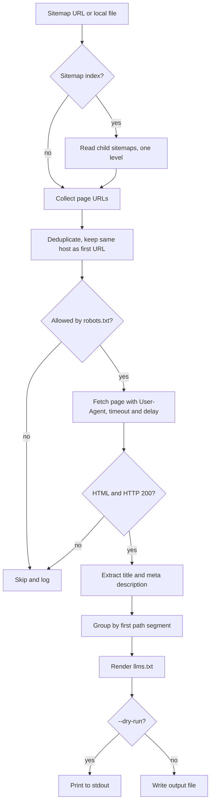

# GEO / AEO Toolkit

Practical tools for making a website easier for answer engines and AI search systems to understand.

Maintained by Usama Afzall, Shopify developer and technical SEO specialist, founder of [Website Prism](https://websiteprism.com). Portfolio: https://usama.websiteprism.com

## What is in this repo

| File | Purpose |
|---|---|
| `llms_txt_generator.py` | Command line tool that builds an `llms.txt` file from a sitemap. Python 3.9+, standard library only. |
| `schema_templates.md` | Copy-paste JSON-LD templates: Organization, WebSite, FAQPage, Product, LocalBusiness, Article. |
| `ai_visibility_checklist.md` | Audit checklist with each item labelled as verified guidance, good practice or hypothesis. |

## An important caveat first

AI search systems (ChatGPT search, Perplexity, Gemini, Google AI Overviews and others) do not publish their ranking or citation rules. Nothing here is a guarantee that any system will cite or recommend a site. The tools and checklist describe good-practice signals and hypotheses that make content clearer and easier to parse. Results are not guaranteed and should be measured, not assumed.

## Usage: llms.txt generator

No installation and no dependencies.

```bash
# Preview from a live sitemap, nothing is written
python3 llms_txt_generator.py https://example.com/sitemap.xml --dry-run

# Write llms.txt with a custom name and summary
python3 llms_txt_generator.py https://example.com/sitemap.xml \
  --site-name "Example Co" \
  --summary "Example Co sells handmade ceramics and publishes care guides." \
  --output llms.txt

# Local sitemap file, gentler crawl, capped at 25 pages
python3 llms_txt_generator.py ./sitemap.xml --delay 2 --max-pages 25 --timeout 15

# Put extra first path segments into the Optional section
python3 llms_txt_generator.py https://example.com/sitemap.xml --optional "press,careers"
```

Options:

| Option | Default | Meaning |
|---|---|---|
| `sitemap` | required | Sitemap URL or local path. Sitemap index files are followed one level deep. |
| `-o`, `--output` | `llms.txt` | Output file path. |
| `--site-name` | homepage title, else hostname | The H1. |
| `--summary` | homepage meta description | The blockquote. |
| `--dry-run` | off | Print to stdout, write no file. |
| `--max-pages` | 50 | Maximum pages fetched. |
| `--delay` | 1.0 | Seconds between page requests. |
| `--timeout` | 10 | Per-request timeout in seconds. |
| `--user-agent` | built in | Sent with every request and used to match robots.txt rules. |
| `--optional` | empty | Extra comma separated first path segments for the Optional section. |

Progress and skipped pages are logged to stderr. Exit codes: `0` success, `1` nothing usable (no pages, or write failure), `2` the sitemap could not be read.

### Example output

```markdown
# Acme Demo Store

> Demo store selling widgets.

## Main

- [Acme Demo Store](https://example.com/): Demo store selling widgets.

## Blog

- [Post One](https://example.com/blog/post-1): First and best post.

## Optional

- [Terms](https://example.com/legal/terms): Terms of use.
```

Pages are grouped by first URL path segment. Home page and top-level pages go in `Main`. A built-in list of segments (privacy, terms, legal, tag, author, cart, account, login and similar) is placed in `Optional`.

## What the tool does



## Limitations (please read)

- `llms.txt` is a community proposal (see https://llmstxt.org), not an adopted standard. Major AI providers have not committed to using it, and no one has shown that having one changes whether a site is cited. Treat it as low-cost documentation, not a ranking lever.
- The tool reads only the `<title>` and meta description of each page. If those are missing or weak, the output will be too. It does not render JavaScript, so pages that inject titles client-side will look empty.
- Grouping by first path segment is a heuristic. Review and edit the result by hand before publishing it at `/llms.txt`.
- Robots.txt handling uses Python's `urllib.robotparser`, which implements the original robots exclusion rules and may differ from search engines on edge cases such as wildcards.
- Only one level of sitemap index nesting is followed, gzip sitemaps are not supported, and pages on a different host than the first sitemap URL are skipped.
- Tested against a small local test site only (normal run, dry run, robots.txt disallow, 404 page, sitemap index). It has not been tested at large scale.

## License

Source-available, not open source. You may read and evaluate this code, but commercial or production use requires a written licence from Usama Afzall. See `LICENSE` and https://usama.websiteprism.com/contact.

Need this customized? https://usama.websiteprism.com/contact
